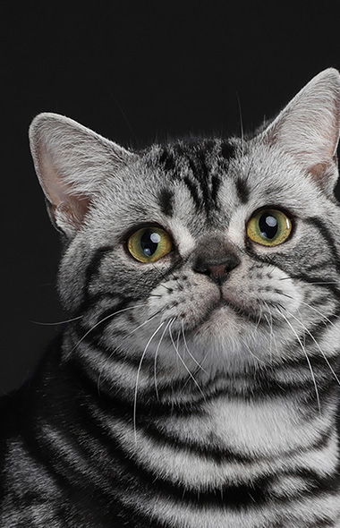
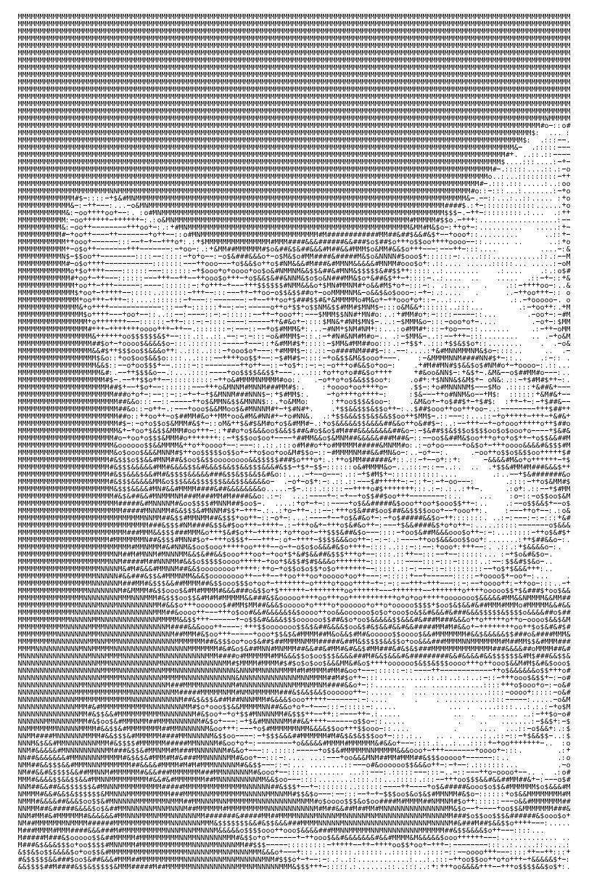
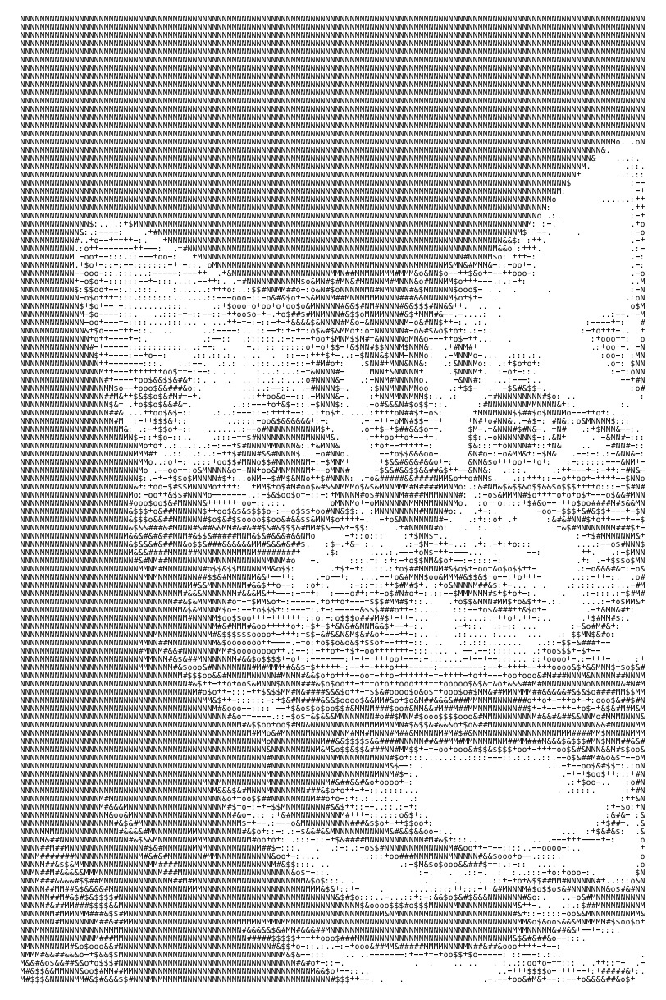

# zebra-sticker-generator

Convert an image into ASCII art and print it as a sticker on a Zebra (ZPL) printer.

## Example

<table>
  <tr>
    <th>Original image</th>
    <th>Sticker (default)</th>
    <th>Sticker with <code>-contrast 1.5</code></th>
  </tr>
  <tr>
    <td></td>
    <td></td>
    <td></td>
  </tr>
</table>

The labels are 4x6 in at 203 dpi, rendered from the generated ZPL with the
[Labelary viewer](https://labelary.com/viewer.html):

```sh
zsticker -f docs/images/graycat.jpg -o graycat.zpl                 # default (auto-levelled)
zsticker -f docs/images/graycat.jpg -contrast 1.5 -o graycat.zpl   # extra contrast
```

With `-contrast 1.5`, the black background becomes solid dense characters and the
cat's stripes and face separate more sharply from it.

## Install

Requires Go 1.22+.

```sh
go install github.com/mpierini/zebra-sticker-generator/cmd/zsticker@latest
# or, from a checkout:
go build -o zsticker ./cmd/zsticker
```

## Usage

The image can be a PNG, JPEG or GIF file, base64-encoded image data, or a data URL
(`data:image/png;base64,...`). ZPL is written to stdout unless `-o` is given.

```sh
zsticker -f cat.png -o cat.zpl              # from a file
base64 -i cat.png | zsticker > cat.zpl      # base64 via stdin
zsticker -f cat.png -ascii -invert > cat.zpl  # preview ASCII in the terminal, invert shading
zsticker -f cat.png -width-in 2 -height-in 1 -o small.zpl
zsticker -f cat.png -contrast 1.5 -o cat.zpl  # extra contrast on top of auto-levels
```

Tones are auto-levelled by default so every image uses the full range of characters;
pass `-autolevel=false` to keep the original tones.

Run `zsticker -h` for all flags. Defaults: 4x6 in label, 203 dpi, ASCII sized to fit the label.

## Previewing without a printer

Paste the ZPL into the [Labelary viewer](https://labelary.com/viewer.html) (8 dpmm, 4x6 in).

## Printing

Most networked Zebra printers accept raw ZPL on port 9100:

```sh
nc <printer-ip> 9100 < cat.zpl
```

## Development

```sh
go vet ./... && go test ./...
```
